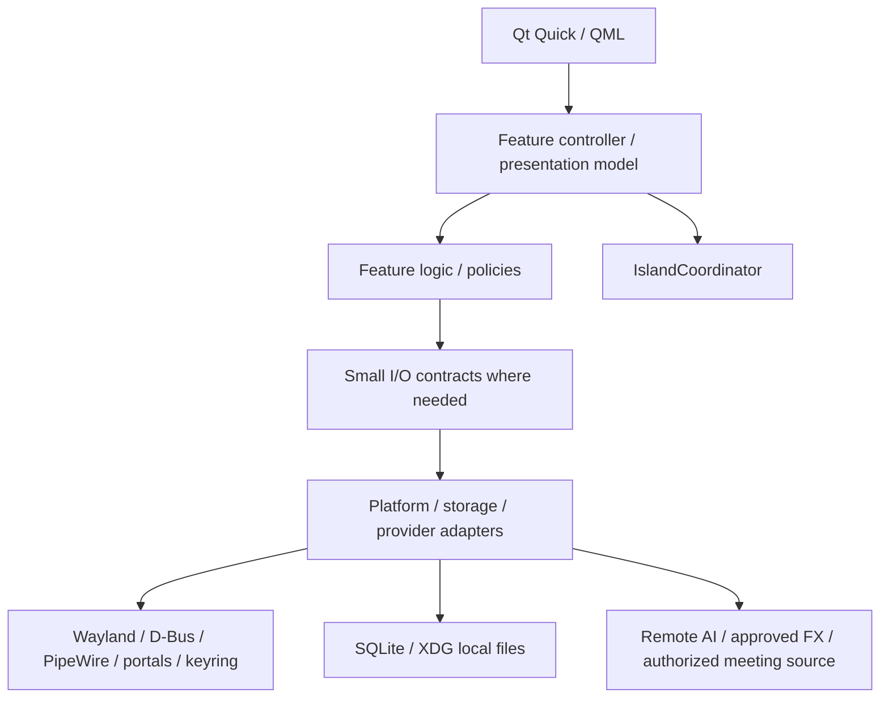

# Arsitektur Pippo

| Metadata | Nilai |
|---|---|
| Versi dokumen | 1.11 |
| Diperbarui | 2026-11-17 |
| Status | Proposed engineering baseline; belum diimplementasikan/divalidasi |
| Constraint produk | C++20, Qt 6 / Qt Quick / QML; KDE Plasma Wayland + Hyprland x86_64 |

[Indeks](README.md) · [PRD](PRD.md) · [Fitur](FEATURES.md) · [Tech stack](TECH-STACK.md) · [Current state](CURRENT-STATE.md)

Dokumen ini memiliki rancangan, boundary dan target struktur source. Semua nama class/path di bawah adalah usulan, bukan berkas yang sudah ada. Layout source aktual, entry point dan kontrak yang sudah dibuat ada di [CODEMAP](CODEMAP.md); status fitur ada di CURRENT-STATE. Kebijakan versi/dependency dan satu-satunya contoh build dimiliki TECH-STACK; kontrak fitur dimiliki FEATURES.

## 1. Pendekatan

Gunakan satu aplikasi/proses native berupa modular monolith, feature-first, MVVM-lite, dengan ports/adapters hanya pada boundary I/O yang membutuhkan variasi backend atau fake untuk test. Ini mempertahankan arah rancangan v1.2, tanpa mengharuskan empat layer/folder untuk setiap fitur.

- C++ menangani integrasi OS, rules, models dan persistence. QML menangani presentasi, interaksi dan animasi.
- Controller/presentation model per fitur mengekspos state/action melalui QObject, properties dan signals. Daftar dinamis memakai model daftar; satu angka tidak memerlukan list model.
- Implementasi protokol/SDK disimpan pada adapter terkait; composition root memasangnya secara eksplisit.
- Mulai dari satu executable. Ekstrak target `pippo_core` / `pippo_platform` hanya jika pengujian atau modularitas benar-benar memerlukannya.
- Hindari global event bus, service locator, framework DI, command bus, generic repository/manager, plugin system, microservices atau daemon tambahan tanpa kebutuhan terukur.

Manfaat yang dituju: lokasi perubahan mudah ditemukan, UI tidak memuat business logic, test boundary sederhana, serta tidak ada biaya IPC antarfitur. Trade-off: disiplin lifetime/thread C++ dan biaya runtime/deployment Qt perlu dibuktikan melalui benchmark dan packaging.

## 2. Alur dan aturan dependency



Panah menunjukkan penggunaan runtime. Compile-time feature core bergantung pada kontrak yang diperlukan, adapter memenuhi kontrak tersebut; jangan membentuk include cycle.

| Boundary | Tanggung jawab | Batas |
|---|---|---|
| QML view | Layout, animation, accessibility labels, local UI state | Tanpa SQL, network, D-Bus, shell command, filesystem atau kalkulasi domain. |
| Controller/model | Observable UI state, actions, validation antarmuka, hasil async, user-facing errors | Tanpa parsing protokol OS/HTTP/SQL atau orchestration seluruh aplikasi. |
| Feature logic | Retention, rounding, scheduling, selection, rules dan policies | Tidak bergantung pada window/QML item. Logic sederhana boleh satu function/type. |
| Adapter | Protocol/API, storage, capability probe, error mapping | Tidak menentukan layout/animasi atau prioritas UX. |
| Composition root | Lifecycle, dependency wiring, capability registration | Tidak mengambil alih business logic tiap fitur. |

Feature A tidak meng-include controller feature B untuk membuka panel. Hubungkan signal-slot/action eksplisit melalui bootstrap/shell. Ekstrak value/contract kecil hanya ketika konsep benar-benar dipakai bersama; tanpa `utils/`, `helpers/`, atau `common/` sebagai dumping ground. Satu public type per pasangan h/cpp adalah default, tiny related types boleh bersama.

## 3. Shell dan arbitrase event

`IslandCoordinator` hanya memiliki shell state, active panel, prioritas event, bounded queue/dedupe, hover debounce, timeout dan request membuka panel. Ia tidak menyimpan clipboard, mengirim prompt, mengatur graph audio atau mengambil kurs.

Nama state/behavior mengikuti FEATURES: `collapsed`, `peek`, `expanded`, `live_activity`, dan `hidden`. Live activity berakhir dengan kembali ke state sebelumnya; hidden mencakup fullscreen, DND/manual hide sesuai policy, dan screen lock. Simpan satu sumber kebenaran state di C++; QML mengikuti properties/signals. State ini bukan skema yang sudah diimplementasikan.

Prioritas: aksi user → incoming call/approval urgent sesuai DND/OS → meeting/reminder → agent completion → media/audio → passive stats. Event tidak mengambil fokus dari notes/AI atau membanjiri popup. Collapsed hanya indikator ringkas; expanded menyediakan menu penuh; fullscreen hide secara default. Nilai timing dan geometri rencana ada di FEATURES, bukan diduplikasi di sini.

## 4. Target layout source

Pohon berikut menunjukkan lokasi, bukan daftar file yang harus dibuat sekaligus.

```text
pippo/
├── AGENTS.md                         # pointer dan aturan kerja agent
├── CMakeLists.txt                     # belum ada; dependency/configuration ringkas
├── CMakePresets.json                  # opsional ketika benar-benar dipakai
├── LICENSE-MIT / LICENSE-APACHE       # wajib sebelum publikasi; belum ada
├── cmake/                            # hanya bila helper nyata diperlukan
├── src/
│   ├── app/                          # AppBootstrap, lifecycle, manual wiring
│   ├── features/
│   │   ├── shell/                    # IslandCoordinator dan state policy
│   │   ├── system/                   # CPU/RAM, battery, clock, controls
│   │   ├── media/                    # player selection dan media model
│   │   ├── audio/                    # stream/device models dan commands
│   │   ├── clipboard/                # history, retention, capture policy
│   │   ├── notes/                    # edit/search/autosave
│   │   ├── prayer/                   # offline calculation dan reminder policy
│   │   ├── ai/                       # provider profiles, submit/cancel policy
│   │   ├── fx/                       # quote, estimate, freshness
│   │   ├── calendar/                 # lokal: month, Today, locale, selection
│   │   ├── notifications/            # hub, DND, privacy, dedupe
│   │   ├── meetings/                 # event source, T−5, Join, call capability
│   │   ├── reminders/                # repeat rules, next-due, snooze, recovery
│   │   ├── agents/                   # opt-in event validation/action gating
│   │   ├── caffeine/                 # inhibitor lifetime dan expiry
│   │   └── settings/                 # preferences dan enabled features
│   ├── platform/                     # adapter nyata: Wayland, MPRIS, PipeWire,
│   │                                 # clipboard, notifications, shortcuts,
│   │                                 # network/Teams, storage, keyring, inhibit
│   └── Pippo/App/                    # main.cpp + QML URI Pippo.App
│       ├── CMakeLists.txt
│       ├── main.cpp                  # app/engine setup + bootstrap
│       ├── Island.qml                # composition shell
│       ├── components/               # Pill, controls, badges
│       └── panels/                   # panel per fitur, termasuk meeting,
│                                     # reminders, agents dan Caffeine
├── tests/                            # integration, E2E, benchmarks, fixtures
├── resources/                        # icons dan i18n
├── packaging/                        # deb, rpm, arch sesuai target teruji
└── docs/                             # indeks aktual: docs/README.md
```

Unit/controller tests boleh berada di `src/features/<fitur>/tests/` dekat pemilik logic. Integration/E2E/benchmark lintas boundary ada di `tests/`. Jangan membuat dua salinan test yang sama.

`src/Pippo/App` adalah pilihan layout proyek yang selaras dengan URI, bukan kewajiban Qt untuk executable backing target. `qt_add_qml_module` menangani resources/metadata/cache QML; lihat contoh dan [referensi resmi](https://doc.qt.io/qt-6/qt-add-qml-module.html) pada TECH-STACK. Entry point tetap kecil, tanpa business logic.

Nama class PascalCase (`AudioController`, `CalendarModel`); folder fitur lowercase; port bernama domain (`AudioGraphPort`) ketika seam diperlukan; QML PascalCase dengan nama panel jelas; tests `<Type>Test.cpp`; target CMake prefix `pippo_` kecuali executable `pippo`.

Konvensi ini juga yang membuat CODEMAP bisa dipakai tanpa membaca seluruh source: satu folder per fitur, nama file sama dengan nama public type, dan wiring antarfitur hanya di bootstrap/shell. Penyimpangan dari layout ini dicatat di CODEMAP §6.

## 5. Boundary dan pemilik fitur

Semua lokasi di tabel adalah rencana relatif terhadap `src/`.

| FR | Pemilik logic/presentation | Backend/boundary | Batas kontrak |
|---|---|---|---|
| Shell, FR-10 | `features/shell`, `features/settings` | Wayland/Layer Shell, preferences | Tidak mengubah panel; focus/fullscreen sesuai policy. |
| FR-01/02/05 | `features/system` | `/proc`, UPower, BlueZ, NetworkManager, brightness backend | Hasil OS authoritative; absent/permission menjadi state nyata. |
| FR-03 | `features/media` | MPRIS | Bounded artwork; controls hanya jika capability ada. |
| FR-04 | `features/clipboard` | Backend desktop + SQLite/blob store | Restore, bounded capture, retention/pin OQ-36. |
| FR-06 | `features/notes` | SQLite store sederhana | Autosave tidak merusak versi tersimpan terakhir. |
| FR-07 | `features/prayer` | Kalkulasi lokal + timezone | Metode terverifikasi; location opt-in. |
| FR-08/09 | `features/ai` | HTTP/SSE provider + keyring | Remote BYOK; SSO P2; tanpa WebEngine. |
| FR-12 | `features/fx` | Configured GET endpoint; JSON field mapping / raw decimal | MoneyMatch profile dipilih OQ-21; fixed-point, fetched-at vs provider timestamp, parse error/stale fallback; tanpa HTML scraping. |
| FR-13 | `features/calendar` | Qt date/locale APIs lokal | Tanpa network, holiday provider/cache, atau persistence wajib. |
| FR-14 | `features/audio` | PipeWire graph; shortcut portal/fallback | OQ-25 A: active playback volume/mute/output; per-app mic/custom permanent routing ditunda. Move stream ≠ default sink. OQ-26 A: shortcut kosong/configurable dan konflik ditampilkan; capability tetap perlu diuji. |
| FR-11/15 | `features/notifications`, lifecycle `app` | Own publisher + allowed observer | First-party selalu; capture eksternal opt-in; no takeover. |
| FR-16/17/18 | `features/meetings` | OQ-27 A: authorized Microsoft calendar sync + manual time/link fallback; Teams adapter teruji | Kalender sync menunggu consent dan validasi tenant. Join membuka flow; call action gated, bukan bot calling control. |
| FR-19 | `features/agents` | Codex CLI pertama (OQ-30 A); authenticated event transport belum dipilih/diverifikasi | Satu adapter opt-in dahulu; validate/dedupe/expiry; tanpa asumsi hook/API tersedia. OQ-31 A: notifikasi + Open Agent saja pada v1, tanpa direct Approve/Reject request; pending mengikuti source, tanpa auto-approve. |
| FR-20 | `features/reminders` | SQLite + single next-due timer | Tidak menjalankan command; resume/timezone catch-up bounded. |
| FR-22 | `features/caffeine` | Portal/compositor inhibitor teruji | OQ-33: OFF, aktivasi default 30 menit/display idle; suspend opt-in. RAII; state backend authoritative; off/expiry melepaskan, status/off control untuk indefinite. |
| FR-21 | Belum dibuat; P2 saja | OQ-34 DEFERRED; tunggu contoh API/auth dari owner | Tidak membuat folder/interface/dependency/polling sebelum kontrak tersedia; bukan gate P1. |

Meeting/prayer dapat memakai kemampuan scheduler bersama lewat kontrak kecil setelah kebutuhan nyata terbentuk. Policy occurrence, consent, DND dan source tetap milik fitur terkait; jangan menyatukannya menjadi satu manager besar. Notification hub mempresentasikan event yang diizinkan tanpa mengambil alih source business logic.

## 6. Threading, lifetime, dan alur async

GUI thread memiliki engine/window, UI-facing QObject, list models, dan shell state. Hindari blocking network, image decode/SQL berat, process wait atau I/O sinkron di thread ini. Gunakan API Qt async dan signal subscriptions; worker terbatas hanya untuk pekerjaan blocking/berat yang terukur, termasuk native PipeWire loop bila diperlukan.

Worker mengirim value/immutable data melalui queued delivery ke thread pemilik UI model. Jangan mengubah `QAbstractListModel` dari worker. Connection context/QPointer menghindari callback ke QObject yang sudah dihancurkan. DB connection dipakai dan ditutup pada thread pemiliknya.

Gunakan RAII atau Qt parent ownership dengan aturan yang jelas; jangan menggabungkan owning unique_ptr dan QObject parent secara ambigu. Hindari raw allocation tanpa owner, manual delete lintas thread atau shared mutable state yang tersebar.

Contoh alur audio: user action → validasi stream/value → request async backend → backend update/error → model UI berubah atau menampilkan alasan gagal. Dispatch request bukan konfirmasi sukses. Notifikasi: own event / allowed forwarder → privacy/DND/dedupe policy → bounded hub model → UI, tanpa duplicate OS toast.

Ketika fitur dimatikan atau aplikasi keluar: hentikan timer/subscriptions, batalkan network request, lepas inhibitor, flush state yang perlu disimpan, tutup DB pada owner thread dan hentikan worker secara terukur. Error satu provider/adapter tidak boleh mematikan shell atau fitur lain.

## 7. State, persistence, dan keamanan

Transient: shell/active panel, stream/device list, current media, pending UI operation. Jangan menyerialisasi seluruh runtime hanya untuk memulihkan tampilan identik.

| Data | Rancangan penyimpanan | Policy |
|---|---|---|
| Preferences dan feature flags | QSettings di lokasi XDG | Tanpa credential; bukan seluruhnya SQLite. |
| Notes, clipboard metadata, reminders | SQLite | Transactions, migration/backup, corruption tanpa overwrite diam-diam. |
| Clipboard image yang harus survive restart | Data lokal XDG + metadata DB | Tidak mengandalkan volatile cache untuk history durable; quota/validation sama dengan FR-04. |
| Thumbnail/artwork yang dapat dibentuk ulang | XDG cache | Bounded, lazy decode/load. |
| API keys dan OAuth tokens | Secret Service/keyring | Tanpa plaintext config/log. |
| AI history | Memory default; persist hanya jika user memilih | Local-only; tidak mengirim konteks otomatis. |
| FX quote | Memory / optional last-good cache | Source/timestamp/stale; no fake rate. |
| External notifications / agent payload | Memory default, bounded | Third-party disk history hanya opt-in; redact secrets. |
| Meeting schedule | Cache lokal jika sync diaktifkan | Freshness, consent, token keyring; format/retention belum final. |
| Calendar month/date selection | Transient/local calculation | Tidak ada holiday dataset, provider setting, atau table wajib. |

Gunakan lokasi XDG per user; tanpa root/system write tersembunyi. Data privat v1 belum wajib dienkripsi at rest (OQ-19), tetapi permissions/consent/redaction tetap wajib. Kontrak storage dan IPC final belum ada; tulis ketika implementasi dipilih, jangan menganggap tabel di atas sebagai skema database/API yang sudah tersedia.

Status UI sederhana dapat berupa Ready/Loading/Unavailable/PermissionRequired/Error; capability Supported/Unsupported/NeedsPermission/TemporarilyUnavailable dengan alasan. Ini pola rencana, bukan kewajiban enum global. Backend tetap sumber kebenaran; error harus dapat dibedakan dari data kosong. Network menggunakan TLS, timeout, payload limits dan retry sesuai policy; tidak ada hidden retry request AI berbayar.

## 8. Quality dan review

Budget performance canonical ada di PRD Q-1 sampai Q-4; gate dan bukti di VALIDATION. Optimasi utama: lazy panel, bounded cache/queue, adaptive sampling, event subscriptions, transform/opacity secukupnya, tanpa animasi terus-menerus saat idle/hidden/reduced motion. Jangan memasang polling 16 ms untuk seluruh fitur.

Review perubahan memastikan boundary tepat, validation/error handling tetap ada, object/thread lifetime aman, disable menghentikan workload, capability unavailable jujur, logs tidak memuat data sensitif, dan test sesuai risiko. Prinsip SOLID dipakai untuk memisahkan tanggung jawab nyata; tidak setiap function perlu interface atau layer tambahan.

Soft review triggers (bukan limit CI): main.cpp sekitar 80-100 LOC, bootstrap 200-250, implementasi beberapa tanggung jawab 250-350, QML 180-250, metode kompleks 40-60, constructor 6-8 dependency. Evaluasi alasan berubah dan coupling sebelum memecah file; jangan split hanya demi jumlah baris. Shared abstraction perlu consumer nyata atau seam testing/variasi backend yang jelas.

## 9. Urutan implementasi yang disarankan

1. P0 shell minimal: bootstrap, shell, media/system pilot, QML composition, Layer Shell; uji dua desktop, input/focus/fullscreen dan benchmark.
2. P0 spike risiko: clipboard, audio routing, shortcut fallback, notification observation, Teams action probe, scheduler/idle inhibitor, Calendar offline dan FX permission. Rekam capability dan bukti; bukan produksi adapter untuk API yang belum diizinkan.
3. P1 MVP: battery, audio/controls, clipboard, notes/keyring, remote AI, first-party alerts, reminders/Caffeine dan satu adapter agent; tambah file hanya saat fitur dikerjakan.
4. P1 completion: salat, brightness internal, Calendar, FX gated, meeting/Join/call gated, external notifications sesuai adapter, a11y/i18n/multi-monitor dan packaging.
5. Readiness: unit/controller/adapter/UI/E2E sesuai VALIDATION, soak/benchmark, license audit, paket dan dokumen penggunaan berdasarkan perilaku nyata. P2 menunggu scope/kontrak tersendiri.

Arsitektur baru dianggap tervalidasi setelah bukti lifecycle, overlay kedua desktop, focus/state, MPRIS pilot, responsive GUI, lifetime/threading, test seams, packaging, source gates dan benchmark tersedia. Saat ini tidak ada bukti tersebut. Keputusan signifikan berdasarkan hasil dicatat sebagai ADR saat diperlukan; belum ada ADR bernomor yang sudah dibuat/disetujui.

## 10. Referensi dan pemeliharaan

[TECH-STACK](TECH-STACK.md) memiliki referensi API/dependency; [DECISIONS](DECISIONS.md) memiliki keputusan/OQ termasuk Qt minimum, default audio, Teams, agent dan Caffeine. [CHANGELOG](CHANGELOG.md) menyimpan riwayat arsitektur v1.1 sampai revisi ini. Profil FX endpoint/mode response berada di FEATURES; jangan membuat SDK/adapter per provider jika HTTP dan dua mode parsing tersebut cukup. Semua dokumentasi produk tinggal di `docs/`; root AGENTS adalah entry point instruksi agent, dan license/build/manifest tetap artefak teknis pada lokasi yang dibutuhkan tooling.
